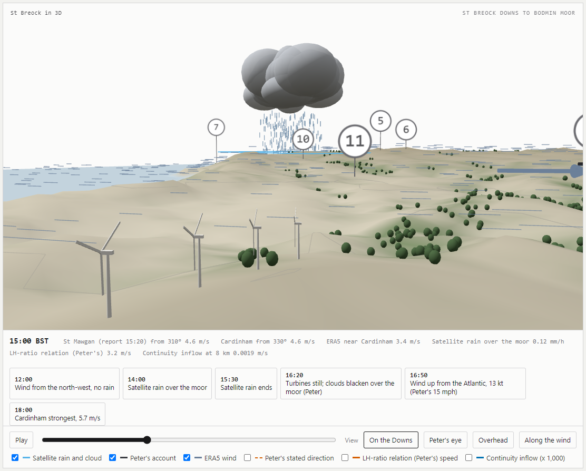

# St Breock in 3D

North Cornwall from Padstow to Fowey on the afternoon of 24 July 2018, every half hour from 12:00 to 20:30 BST: the wind measured at St Mawgan and Cardinham, satellite rain over Bodmin Moor, the ERA5 wind field, woodland, and the clouds two walkers on St Breock Downs saw darken over the moor at about 4 pm.

Live page: https://r3genesi5.github.io/st-breock-3d/

`index.html` is the whole page (three.js 0.160.0 from jsDelivr). `data/` holds the numbers it is built from and `build/` the scripts that fetched the terrain, ERA5 and woodland data; the station records and satellite rain extracts are restated in `data/e3_3d_data.json`. The walkers' account is from Peter Bunyard's letter of 24 July 2018, paraphrased.

## Data and credits

- Terrain: Copernicus DEM GLO-90 (© DLR e.V. 2010-2014 and © Airbus Defence and Space GmbH 2014-2018, provided under COPERNICUS by the European Union and ESA), via the Open-Meteo elevation API.
- Wind field: ERA5, Hersbach et al. (2020), Copernicus Climate Change Service, via the Open-Meteo historical archive. Reanalysis, not measurement.
- Rain: GPM IMERG V07 half-hourly, NASA GES DISC.
- Station winds: Met Office St Mawgan (EGHQ) via the Iowa Environmental Mesonet; Cardinham (WMO 03823) via NOAA ISD.
- Cloud depth: Camborne 12 UTC sounding, University of Wyoming.
- Woodland: Hansen et al. (2013), Science 342, 850-853; Global Forest Change v1.11, CC BY 4.0.

Ali Bin Shahid, October 2026.
